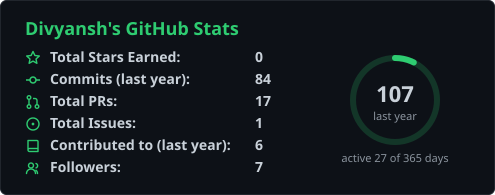
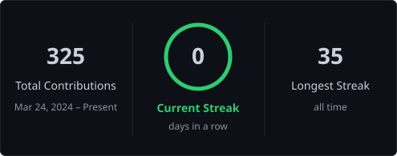
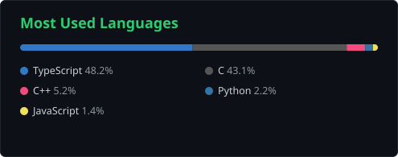
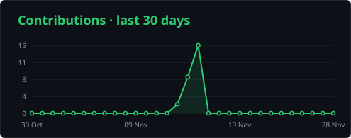

  

  
  
  
  

---

### 🧑🏻‍💻 About Me

I'm an **Electronics & Communication Engineering** undergraduate at **IIIT Dharwad** (Minor in VLSI), working across the chip-design flow: **RTL design, functional verification, synthesis, physical design** and, more recently, **device-level TCAD**.

- ✈️ **Now:** Microelectronics Intern at **Boeing**
- 🧩 **Silicon:** verification & physical design on **SIDHARUD1**, a RISC-V SoC taped out on GlobalFoundries 180 nm
- 🔬 **Research:** radiation-tolerant CMOS and 6T SRAM through TCAD–SPICE co-simulation
- 🏛️ **Community:** former President of the **[GND_0 VLSI Club](https://github.com/GND-0)**

**Current focus:** design verification · low-power design & DFT · physical design & timing closure · SoC integration

 

---

### 💼 Experience

| Role | Organisation | Period |
|:--|:--|:--|
| **Microelectronics Intern** | Boeing | Present |
| **Project Intern**, Verification & Physical Design (SIDHARUD1 SoC) | IIIT Dharwad | May 2025 – Sep 2025 |

<b>SIDHARUD1: what I worked on</b>

 

- Boot ROM verification: instruction flow and memory-map checks
- SRAM verification across configurations: reset, read/write and timing behaviour
- GPIO verification in port-extender mode using firmware-driven loopback tests
- Netlist verification and Tcl scripting for floorplanning, CTS and routing
- Wire-bond diagram for the 120-pin QFP package in Cadence Virtuoso
- Part of a global university tape-out programme using Synopsys tools, fabricated by GlobalFoundries (180 nm)

---

### 🧰 Tech Stack

| Area | Tools |
|:--|:--|
| **Languages** |       |
| **Synopsys** |       |
| **Sentaurus TCAD** |       |
| **Cadence** |     |
| **Simulation & modelling** |     |
| **FPGA & embedded** |        |
| **Interests** |     |

---

### 🔬 Featured Projects

**Silicon, RTL & verification**

| Project | Highlights | Stack |
|:--|:--|:--|
| **SIDHARUD1**: I²C port-extender ASIC with embedded RISC-V processor | Taped out on GlobalFoundries 180 nm; boot ROM, SRAM and GPIO verification; package wire-bond diagram | Synopsys DC · VCS · ICC2 · Virtuoso |
| **N-Channel Programmable Clock Generator VIP** | Self-checking SystemVerilog VIP; constrained-random multi-clock tests; 72/72 checks, **98.15 %** functional and **100 %** assertion coverage | SystemVerilog · SVA · VCS |
| **UART Communication Core** | TX/RX/baud generator with protocol-violation tests, taken through the full RTL-to-GDSII flow | Verilog · DC · ICC2 |
| **Verilog-2001 Compiler** | Lexer, parser and optimisation passes; **3rd rank**, IEEE CEDA EDA Toolsmith | C++ |
| **Custom Memory Design & Verification** | Scalable 32768×32 hierarchical SRAM with decoding and control logic; parameterised testbenches | Verilog |
| **Custom Processor Design** | RISC/ARM principles, pipelining, Verilog implementation | Verilog |

**Devices & research**

| Project | Highlights | Stack |
|:--|:--|:--|
| **Radiation-Tolerant CMOS & SRAM** *(ongoing)* | 65 nm NMOS/CMOS in TCAD; TID and SEU modelling; LUT compact models → Verilog-A → 6T SRAM in a TCAD–SPICE co-simulation | Sentaurus · HSPICE · Verilog-A |

**Embedded, FPGA & robotics**

| Project | Highlights | Stack |
|:--|:--|:--|
| **Interactive Room Assistant** | Touch-UI room management with live status and air-quality readings; **Best Presentation**, CircuitAvishkar 2.0 | Infineon PSoC Edge · LVGL · SquareLine |
| **Speech-to-Text FPGA System** | Real-time speech recognition on FPGA | FPGA · DSP |
| **Smart Water Management System** | Sensor interfacing and real-time data logging | Embedded C · IoT |
| **Fire Detection Drone** | Autonomous detection with computer vision | Embedded Linux · CV |
| **Line Follower Robot** | PID path correction with an IR array; **3rd prize**, Robolympics at Pravega 2025, IISc | Arduino Nano · PID |

---

### 🏆 Achievements

| Year | |
|:--:|:--|
| 2026 | 🥉 **3rd Rank**, IEEE CEDA EDA Toolsmith: Verilog compiler design (BIT Bengaluru) |
| 2026 | 🏅 **Best Presentation**, CircuitAvishkar 2.0 by IEEE CAS & Infineon Technologies |
| 2025 | 🎖️ **Samsung Fellowship (Grade I)**, Indian Semiconductor Workforce Development Program |
| 2025 | 🔬 **Summer Research Fellowship (SRFP)**, IISc Bangalore |
| 2025 | 🤖 **3rd Prize**, Robolympics at **Pravega 2025**, IISc Bangalore |
| 2024 | 🎓 **Reliance Foundation Scholar** |

### 🌱 Leadership

- **President, GND_0 VLSI Club** (Oct 2024 – Apr 2026): national-level hackathons, ANRF-sponsored workshops, hands-on sessions on RTL, ASIC flow and verification
- **Technical Lead, IRIS Robotics Club** (Apr 2024 – Apr 2026): embedded, IoT and automation projects

---

### 📊 GitHub Stats

  
  

  
  

Cards are generated daily by this repository's GitHub Actions workflow.

