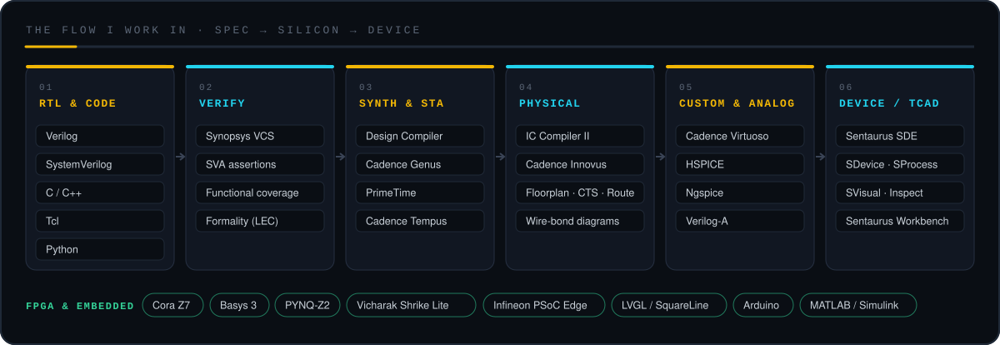
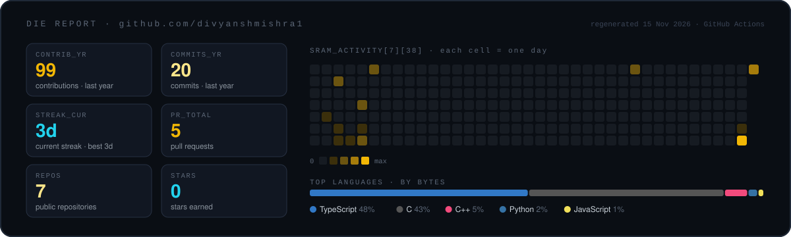

<!-- Profile README · graphics in /assets are hand-built SVGs; stats regenerate daily via .github/workflows -->

<a href="https://www.linkedin.com/in/divyansh-mishra-203664241/">
  
</a>

<div align="center">


<a href="https://www.linkedin.com/in/divyansh-mishra-203664241/"></a>
<a href="https://github.com/GND-0"></a>
<a href="https://github.com/divyanshmishra1?tab=followers"></a>


</div>

---

## ⚡ Right now

<table>
<tr>
<td width="50%" valign="top">

**✈️ Microelectronics Intern @ Boeing**<br/>
<sub>Working in aerospace microelectronics</sub>

**🔬 Radiation-tolerant CMOS & SRAM** <sub>(ongoing)</sub><br/>
<sub>65 nm devices in Sentaurus TCAD → TID/SEU modelling → LUT compact models → Verilog-A → 6T SRAM in a TCAD–SPICE co-simulation</sub>

</td>
<td width="50%" valign="top">

**🎓 B.Tech ECE + Minor in VLSI** · IIIT Dharwad ’27

**🧩 Taped out SIDHARUD1**: a RISC-V SoC on GlobalFoundries 180 nm, with [GND_0](https://github.com/GND-0)

**🏛️ Ex-President, GND_0 VLSI Club** · Ex-Technical Lead, IRIS Robotics

</td>
</tr>
</table>

```systemverilog
class divyansh_mishra extends vlsi_engineer;
  string  role      = "Microelectronics Intern @ Boeing";
  string  focus[$]  = '{"Design Verification", "Physical Design", "STA", "Device/TCAD"};
  string  tapeouts  = "SIDHARUD1 · RISC-V SoC · GF 180 nm";
  string  langs[$]  = '{"Verilog", "SystemVerilog", "C/C++", "Tcl", "Python"};
  int     coverage  = 98;  // % functional coverage on my clock-gen VIP
  string  learning  = "Deutsch 🇩🇪 (490+ day streak)";

  constraint life_c { coffee > 0; slack >= 0; }

  function void run();
    forever @(posedge opportunity) build_silicon();
  endfunction
endclass
```

## 🛤️ Silicon journey



## 🔩 Featured work

<table>
<tr>
<td width="50%" valign="top">

### 🧩 SIDHARUD1 · taped-out SoC
<sub>GND_0 VLSI Club · May–Sep 2025</sub>

Verification and physical-design engineer on a **32-bit RISC-V port-extender ASIC**, fabricated by **GlobalFoundries (180 nm)** through a global university tape-out programme.

- Boot ROM, SRAM and GPIO verification (firmware loopback)
- Tcl flows for floorplan, CTS and routing; netlist checks
- Designed the **wire-bond diagram** for the QFP-120 package in Virtuoso

`Synopsys DC` `VCS` `ICC2` `Virtuoso` · [read more →](https://github.com/GND-0#-tape-out-01--sidharud1-g0sdh3201)

</td>
<td width="50%" valign="top">

### ⏱️ N-Channel Clock Generator VIP
<sub>SystemVerilog · Synopsys VCS</sub>

A parameterised, self-checking **verification IP** (generator, driver, monitor, scoreboard, coverage) that scales to any number of clock channels.

- Constrained-random start/stop, mid-session reset, 1–100 MHz sweeps
- **72/72 checks passing** across 40 sessions
- **98.15 % functional** and **100 % assertion** coverage

`SystemVerilog` `SVA` `Coverage` `VCS`

</td>
</tr>
<tr>
<td width="50%" valign="top">

### ☢️ Radiation-Tolerant CMOS & SRAM
<sub>TCAD–SPICE co-simulation · ongoing</sub>

Cross-level reliability study from **device to circuit**: 65 nm NMOS/CMOS built in Sentaurus, total-ionising-dose and single-event-upset modelling, then exported compact models driving a **6T SRAM** in SPICE.

`Sentaurus SDE/SDevice` `Verilog-A` `HSPICE`

</td>
<td width="50%" valign="top">

### 🛠️ Verilog-2001 Compiler · 🥉 3rd rank
<sub>IEEE CEDA EDA Toolsmith · 2026</sub>

Built a **Verilog-2001 compiler** (lexical analysis, parsing and optimisation passes) for the IEEE CEDA EDA Toolsmith competition at BIT Bengaluru.

`C++` `Compilers` `EDA`

</td>
</tr>
<tr>
<td width="50%" valign="top">

### 📡 UART Core · RTL → GDSII
<sub>Verilog · ASIC flow</sub>

TX, RX and baud generator with protocol-violation testbenches, taken through **synthesis, floorplan, CTS and routing** to GDSII.

`Verilog` `Design Compiler` `ICC2`

</td>
<td width="50%" valign="top">

### 🏠 Interactive Room Assistant · 🏆 Best Presentation
<sub>Infineon PSoC Edge · CircuitAvishkar 2.0 (IEEE CAS)</sub>

A touch-UI room-management system on **PSoC Edge** with LVGL/SquareLine: floor-wise room status and temperature, CO₂ and air-quality readings.

`PSoC Edge` `LVGL` `Embedded C`

</td>
</tr>
</table>

<details>
<summary><b>More builds</b>: memory design, robotics</summary>
<br/>

- **32768 × 32 hierarchical SRAM**: parameterised Verilog memory with address decoding, control logic and testbenches
- **PID line-follower robot**: Arduino Nano + IR array, 🥉 3rd at IISc Robolympics 2025

</details>

## 🧰 Toolchain



## 🏆 Honours

| | |
|---|---|
| 🥉 **3rd rank**, IEEE CEDA EDA Toolsmith: Verilog compiler design | 2026 |
| 🏆 **Best Presentation**, CircuitAvishkar 2.0 (IEEE CAS × Infineon) | 2026 |
| 🎖️ **Samsung Fellowship (Grade I)**, Indian Semiconductor Workforce Development Program | 2025 |
| 🔬 **Summer Research Fellow**, IISc Bangalore (Indian Science Academies' SRFP) | 2025 |
| 🥉 **3rd prize**, Robolympics, IISc Bangalore | 2025 |
| 🎓 **Reliance Foundation Scholar** | 2024 |

<details>
<summary><b>Leadership & training</b></summary>
<br/>

- **President, GND_0 VLSI Club** (Oct ’24 – Apr ’26): ran national hackathons and ANRF-sponsored 5-day workshops on RTL, ASIC flow and semiconductor technology; the club taped out its first chip, SIDHARUD1, during this term
- **Technical Lead, IRIS Robotics Club** (Apr ’24 – Apr ’26)
- Hands-on programmes: RTL-to-GDSII (Synopsys), VLSI Test & DFT, Analog VLSI, device and circuit CAD (Sentaurus, Virtuoso, HSPICE), and Samsung ISWDP Cohort 6 (all tracks)

</details>

## 📊 Die report



<picture>
  <source media="(prefers-color-scheme: dark)" srcset="https://raw.githubusercontent.com/divyanshmishra1/divyanshmishra1/output/snake-dark.svg" />
  <source media="(prefers-color-scheme: light)" srcset="https://raw.githubusercontent.com/divyanshmishra1/divyanshmishra1/output/snake-light.svg" />
  
</picture>

---

<div align="center">

**Building the chips that build the future. Let's talk silicon.**

<a href="https://www.linkedin.com/in/divyansh-mishra-203664241/"></a>
<a href="https://github.com/GND-0"></a>

<sub>Every graphic on this page is hand-built SVG and re-rendered daily by GitHub Actions. <code>timing met · slack ≥ 0</code></sub>

</div>
